# SMuFL Menus for FontLab 8 & 9

**Developed by Nor Eddine Bahha — [NorFonts](https://norfont.com/).**

**Organized SMuFL Encoding menus for FontLab 8 and FontLab 9 (macOS).**

This tool generates native `.enc` files organized by musical function, helping music-font designers browse related SMuFL glyphs directly in FontLab's **Encoding** menu.

> **Status: experimental / community project.** The menu has been inspected in FontLab 8; end-to-end operation across FontLab 8 and FontLab 9 installations is not fully verified. Review the preview before installing.

## FontLab 8 Encoding Menu Gallery

**Encoding menu only — not the left sidebar or Bookmarks panel.** These previews reproduce the dropdown-list styling; they do not suggest that SMuFL folders can be added automatically to FontLab’s sidebar.

**Illustrative previews, not screenshots from live sessions.** The images below recreate the look of the author's FontLab 8 Encoding menu screenshot. Section names, list counts, and shown glyph counts are based on a read-only FontLab 8 inspector; long labels may be abbreviated. Additional lists are summarized where not shown.

<details>
<summary><strong>Show the 23 illustrated SMuFL sections</strong></summary>

### SMuFL Quick

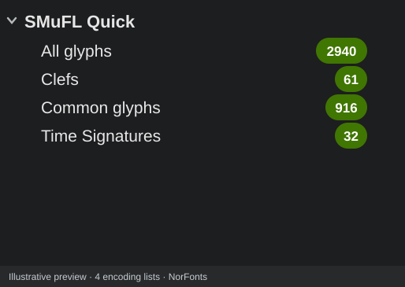

### SMuFL Common

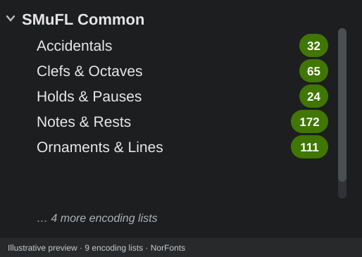

### SMuFL Staff & Clefs

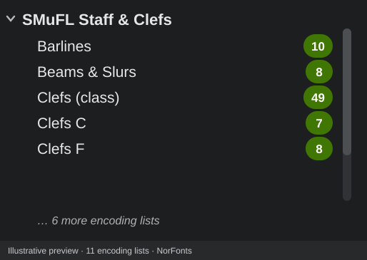

### SMuFL Notes & Rests

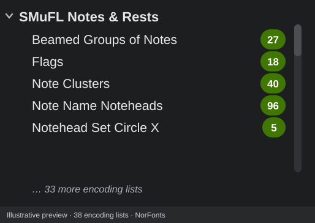

### SMuFL Rhythm & Time

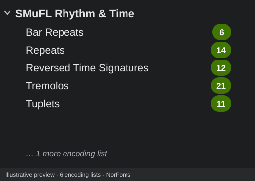

### SMuFL Accidentals

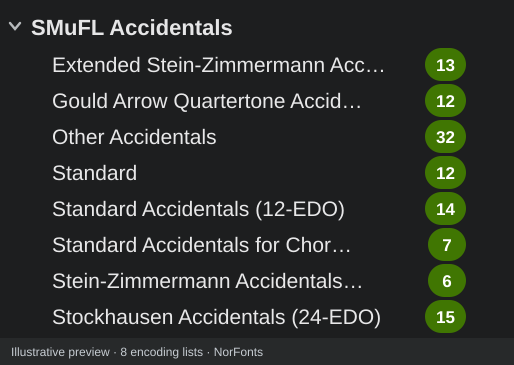

### SMuFL Microtonal

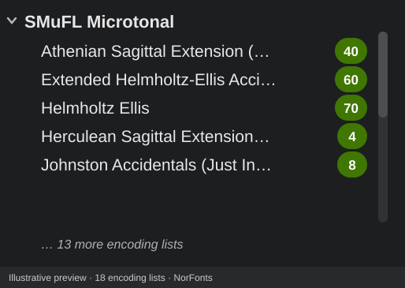

### SMuFL World Music

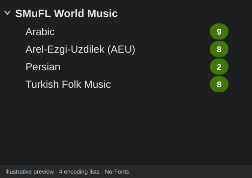

### SMuFL Articulation

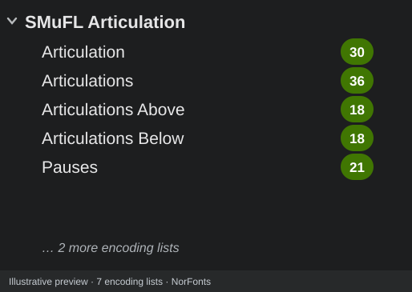

### SMuFL Dynamics

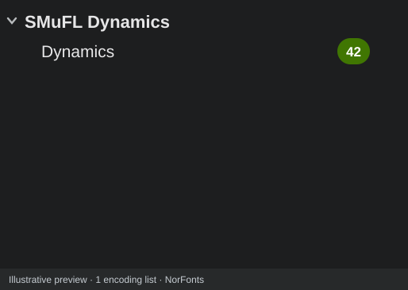

### SMuFL Ornaments

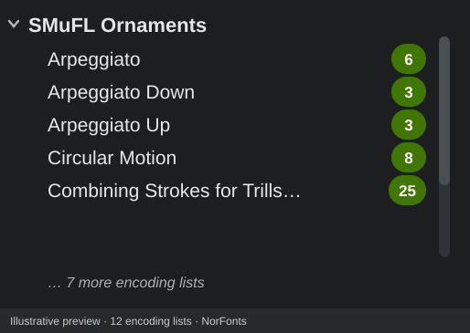

### SMuFL Techniques

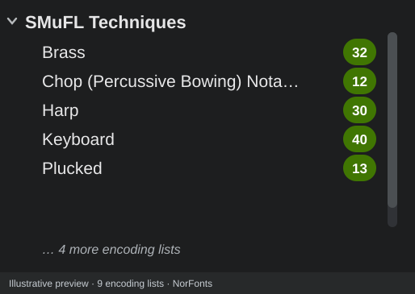

### SMuFL Percussion

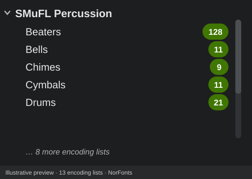

### SMuFL Instruments

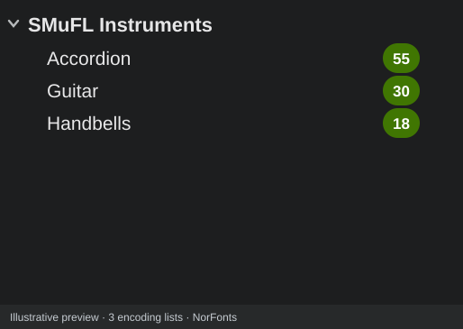

### SMuFL Chords

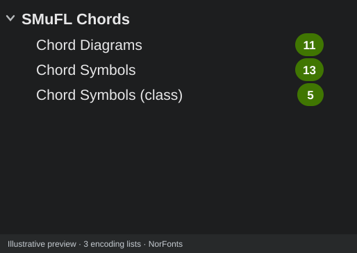

### SMuFL Theory

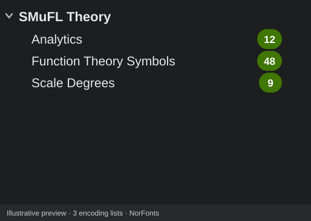

### SMuFL Medieval

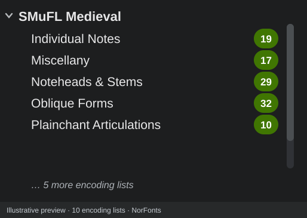

### SMuFL Tablature

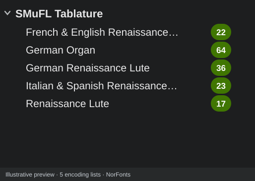

### SMuFL Special Notation

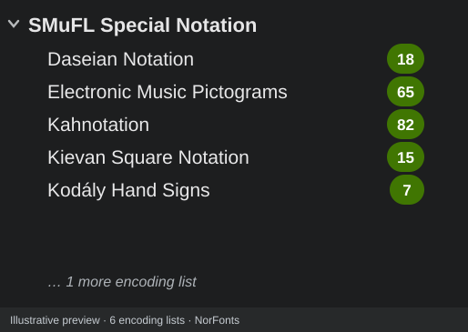

### SMuFL Text & Signs

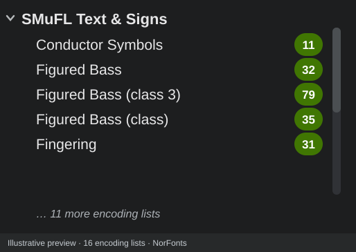

### SMuFL Graphics

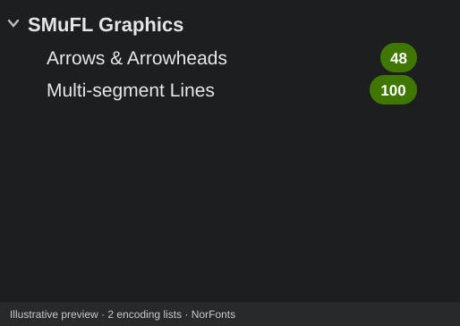

### SMuFL Supplements

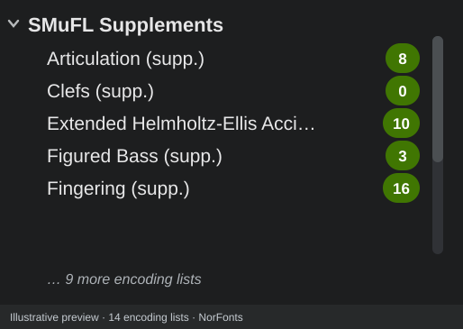

### SMuFL Miscellaneous

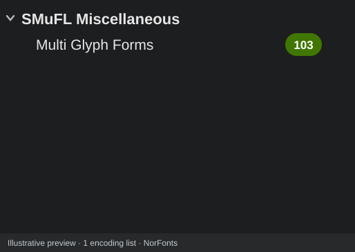

</details>

## Features

- Based on approximately **2,940 glyph definitions** from the upstream project.
- **23 music-oriented groups** and approximately **203 encoding collections** (the exact generated count depends on source version and duplicate consolidation).
- Groups for common notation, clefs, notes and rests, accidentals, microtonal music, medieval notation, percussion, techniques, text and signs, and more.
- Uses **Unicode-style glyph names** such as `uniE050` and `uniE0A4` (extended names `uXXXXX` where appropriate).
- **Add-only** `.enc` creation: existing files are skipped, never replaced.
- `PREVIEW` mode shows planned changes without writing files.

## Requirements

- macOS, FontLab 8 and/or FontLab 9.
- Python **3.9+** available as `python3`.
- Internet access to download the source JSON metadata at runtime.
- Existing FontLab Encoding directories.

## Install

1. Quit FontLab 8 and 9.
2. Extract the project ZIP or clone the repository.
3. Double-click **`Add Organized SMuFL to FontLab 8 and 9.command`** (or launch it in Terminal).
4. Enter **`PREVIEW`** and inspect the planned groups, files, and paths.
5. If the result looks right, run the command again and enter **`ADD`**.
6. Reopen FontLab and find the sections in the **Encoding selector**.

Default destination folders:

```text
~/Library/Application Support/FontLab/FontLab 8/Encoding/
~/Library/Application Support/FontLab/FontLab 9/Encoding/
```

You can generate a preview directly in Terminal:

```bash
python3 smufl_organized.py --preview
```

For available command-line options:

```bash
python3 smufl_organized.py --help
```

## Important safety behavior

The existing generator uses exclusive creation for encoding files. It **never overwrites, renames, deletes, or backs up** existing encoding files, and does not edit FontLab preferences or the application bundles. It refuses to install if destination directories do not satisfy its checks. Previous SMuFL encodings remain visible and must be reviewed separately if you choose to remove them manually. Never run old experimental installers or uninstallers as part of this process.

This does **not** restore missing older custom encodings, and it does **not** automatically add items to FontLab's left-hand **Bookmarks** sidebar. It only generates Encoding menu entries. FontLab matches the generated glyph names against those in the opened font; fonts using canonical SMuFL names will need a different mapping.

## Author

**Nor Eddine Bahha** — [NorFonts](https://norfont.com/)

## Data and credits

The generator downloads JSON metadata from `Shinianqi/SMuFL-Glyphs4` rather than embedding those JSON files in this repository. The metadata is based on the [SMuFL specification](https://www.smufl.org/).

See [NOTICE.md](NOTICE.md) for source attribution and third-party licensing. This repository is a **separate FontLab adaptation**, not an official Glyphs 4 plugin or a W3C/SMuFL endorsed product.

## License

The original adaptation code in this repository is offered under [Apache License 2.0](LICENSE). Third-party content retains its own copyright and license terms; refer to [NOTICE.md](NOTICE.md).